# User Profile { #user_profile }

Use the **User Profile** app to manage your own DHIS2 account. In the app, you can edit your personal details, choose your language and display settings, change your password, turn on two-factor authentication, and create personal access tokens. Administrators manage the accounts of other users in the [Users](#users_app) app.

## Open the app { #user_profile_open }

Open the **User Profile** app from the user menu in the header bar. The names of the menu items depend on your version.

#### v41 and earlier { #user_profile_open_v41_and_earlier }

In v41 and earlier, four items in the user menu open the **User Profile** app.

Table: Items in the user menu that open the User Profile app in v41 and earlier

| User menu item   | Opens                |
| ---------------- | -------------------- |
| **Edit profile** | **User profile**     |
| **Settings**     | **User settings**    |
| **Account**      | **Account settings** |
| **About DHIS2**  | **About DHIS2**      |

#### v43 and later { #user_profile_open_v43_and_later }

In v43 and later, four items in the user menu open the **User Profile** app.

Table: Items in the user menu that open the User Profile app in v43 and later

| User menu item       | Opens                |
| -------------------- | -------------------- |
| **My profile**       | **User profile**     |
| **Settings**         | **User settings**    |
| **Account security** | **Account settings** |
| **System info**      | **About DHIS2**      |

When you open the **User Profile** app without a menu item, the app opens on **Full profile**. If your administrator turned on **Enforce verified emails** and your email address is not verified, the app opens on **User profile** instead. See [Verify your email address](#user_profile_verify_email).

## Sections of the app { #user_profile_sections }

Use the sidebar to move between the sections of the app.

Table: Sections of the User Profile app

| Sidebar item                  | Page heading                      | What you do there                                                 |
| ----------------------------- | --------------------------------- | ----------------------------------------------------------------- |
| **User profile**              | **Edit user profile**             | Edit your personal details, contact details, and profile picture. |
| **User settings**             | **Edit user settings**            | Choose your language, style, and notification options.            |
| **Account settings**          | **Edit account settings**         | Change your password. Go to two-factor authentication.            |
| **Two factor authentication** | **Two-factor Authentication**     | Turn two-factor authentication on or off.                         |
| **Full profile**              | **View full profile**             | Read a summary of your profile.                                   |
| **Personal access tokens**    | **Manage personal access tokens** | Create and delete personal access tokens.                         |
| **About DHIS2**               | **System info**                   | Read information about the DHIS2 instance.                        |

#### v41 and earlier { #user_profile_sections_v41_and_earlier }

-   In v41 and earlier, the sidebar of the **User Profile** app always shows the item **Two factor authentication**.
-   In v41 and earlier, you can turn on two-factor authentication only with an authenticator app, an app on your phone that generates your login codes, for example Google Authenticator.

#### v42 and later { #user_profile_sections_v42_and_later }

-   From v42, the sidebar of the **User Profile** app shows the item **Two factor authentication** only if your administrator turned on at least one two-factor method, or if two-factor authentication is already on for your account.
-   From v42, you can turn on two-factor authentication with an authenticator app, or you can also choose to receive the code by email.

## Edit your profile { #user_profile_edit }

The **User profile** page contains your personal details and your contact details. The following image shows the top of the page, with the fields **First name**, **Surname**, and **Email**, and the **Profile picture** box.

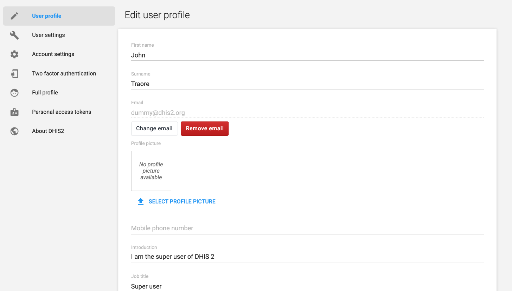

To edit your profile:

1. In the sidebar, choose **User profile**.
2. Change the details that you want to update.
3. Move to another field.

DHIS2 saves each change as soon as you leave the field or choose a value, and shows the message **User profile updated**. The page has no **Save** button.

Table: Fields on the User profile page

| Field                                                                                                       | Notes                                                                                                                                                                                                                                                                                                     |
| ----------------------------------------------------------------------------------------------------------- | --------------------------------------------------------------------------------------------------------------------------------------------------------------------------------------------------------------------------------------------------------------------------------------------------------- |
| **First name**, **Surname**                                                                                 | Required.                                                                                                                                                                                                                                                                                                 |
| **Email**                                                                                                   | See [Change or remove your email address](#user_profile_email).                                                                                                                                                                                                                                           |
| **Profile picture**                                                                                         | See [Change your profile picture](#user_profile_picture).                                                                                                                                                                                                                                                 |
| **Mobile phone number**                                                                                     | Free text. DHIS2 does not check the format. DHIS2 sends SMS notifications to this number when your administrator has set up an SMS gateway and **Enable message SMS notifications** is **Yes** in **User settings**. DHIS2 also matches the sender of an SMS report to the mobile phone number of a user. |
| **Introduction**, **Job title**, **Nationality**, **Employer**, **Education**, **Interests**, **Languages** | Free text. To change the language of the DHIS2 interface, use **User settings**.                                                                                                                                                                                                                          |
| **Gender**                                                                                                  | Choose **Male**, **Female**, or **Other**.                                                                                                                                                                                                                                                                |
| **Birthday**                                                                                                | You cannot choose a date in the future.                                                                                                                                                                                                                                                                   |
| **WhatsApp**, **Facebook Messenger**, **Skype**, **Telegram**, **Twitter**                                  | The account names that you use for direct messaging services. Enter a WhatsApp number as an international phone number, for example +0123456789.                                                                                                                                                          |

### Change or remove your email address { #user_profile_email }

To change your email address:

1. On the **User profile** page, click **Change email**.
2. In **Enter new email**, enter the new email address.
3. In **Confirm new email**, enter the same address again.
4. Click **Save**.

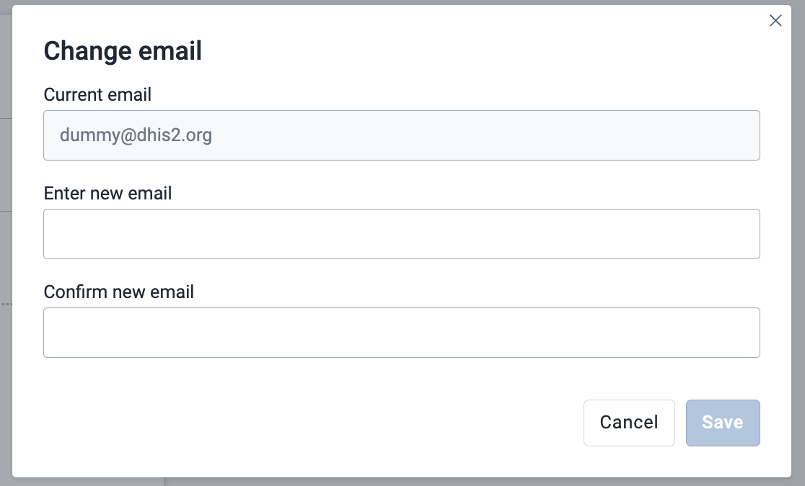

The **Save** button stays disabled until both fields contain the same, valid address. If your current address is verified, the dialog warns that you might need to verify the new address again.

To remove your email address:

1. On the **User profile** page, click **Remove email**.
2. In the dialog, click **Remove email** to confirm.

The **Remove email** button is disabled when you have no email address.

If you use email for two-factor authentication, you cannot change or remove your email address. DHIS2 shows the message **Email update not allowed** and a link to the **Two factor authentication** page. Turn off two-factor authentication by email first, change your address, and then turn on two-factor authentication again.

#### v41 and earlier { #user_profile_email_v41_and_earlier }

-   In v41 and earlier, you change your email address in the **E-mail** field on the **User profile** page.
-   In v41 and earlier, the **User profile** page has no **Change email**, **Remove email**, or **Verify email** button.

#### v42 and later { #user_profile_email_v42_and_later }

-   From v42, you change your email address with the **Change email** button and remove it with the **Remove email** button.

### Verify your email address { #user_profile_verify_email }

The **Verify email** button is available in v42 and later. It appears next to the **Change email** button only if your DHIS2 system is set up to send emails. If the button does not appear, ask your administrator to set up email.

To verify your email address:

1. On the **User profile** page, click **Verify email**.
2. Open the email that DHIS2 sends to your address, and follow the link in it.

After step 1, DHIS2 shows the message **Email verification link sent successfully!**. The button is disabled when your address is already verified or is not valid.

If your administrator turned on **Enforce verified emails** in the [System Settings](#settings) app, the **User profile** page shows this warning until you verify your address: **Your email is not verified. Please verify your email to continue using the system.** If you have no email address, the warning says **Please provide an email and verify it to continue using the system.**

### Change your profile picture { #user_profile_picture }

To add or change your profile picture:

1. On the **User profile** page, under **Profile picture**, click **Select profile picture**.
2. Choose an image file. The file must be smaller than 2 MB.

If the file is too large, DHIS2 shows a message that the picture must be smaller than 2 MB, and does not save it. To remove your picture, click **Remove profile picture**.

## Choose your user settings { #user_profile_settings }

The **User settings** page contains settings that apply to your account only. The following image shows the settings and the system default values next to them.

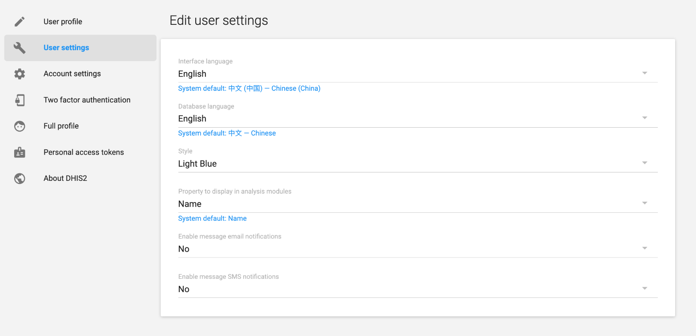

To change a setting:

1. In the sidebar, choose **User settings**.
2. Open the menu of the setting that you want to change, and choose a value.

DHIS2 saves the change as soon as you choose a value, and shows the message **Settings updated**.

Table: Settings on the User settings page

| Setting                                     | Description                                                                                                                                                                                                                 |
| ------------------------------------------- | --------------------------------------------------------------------------------------------------------------------------------------------------------------------------------------------------------------------------- |
| **Interface language**                      | The language of the DHIS2 interface.                                                                                                                                                                                        |
| **Database language**                       | The language of translated metadata, such as the names of data elements and indicators.                                                                                                                                     |
| **Style**                                   | The visual style of DHIS2.                                                                                                                                                                                                  |
| **Property to display in analysis modules** | Choose **Name** or **Short name**. Analytics apps, such as the **Data Visualizer** app, show this property of metadata objects such as data elements and indicators. The setting does not change how your own name appears. |
| **Enable message email notifications**      | Choose **Yes** or **No** to turn email notifications for messages on or off.                                                                                                                                                |
| **Enable message SMS notifications**        | Choose **Yes** or **No** to turn SMS notifications for messages on or off. DHIS2 sends the SMS to your **Mobile phone number**.                                                                                             |

For **Interface language**, **Database language**, **Style**, and **Property to display in analysis modules**, the first value in the menu is **Use system default**, followed by the system value in parentheses. When you choose a value of your own, the page shows the system value under the setting name, for example **System default: Name**.

## Change your password { #user_profile_password }

The **Account settings** page shows your username, the three password fields, and the buttons **Setup 2-Factor** and **Update password**.

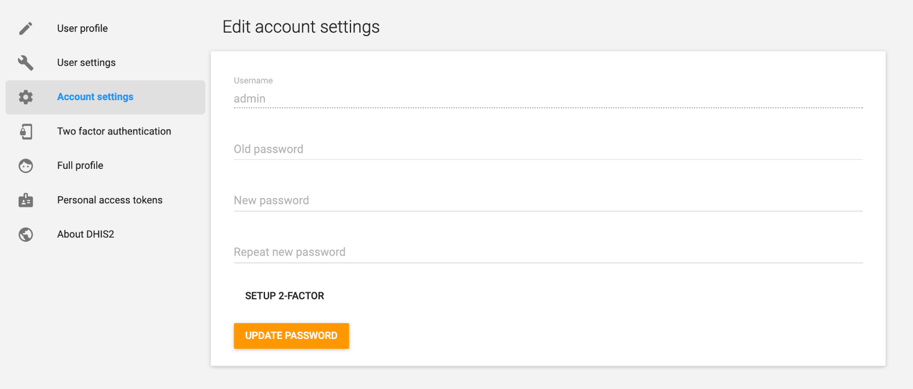

To change your password:

1. In the sidebar, choose **Account settings**.
2. In **Old password**, enter your current password.
3. In **New password**, enter the new password.
4. In **Repeat new password**, enter the new password again.
5. Click **Update password**.

DHIS2 shows the message **Password changed successfully** and tells you that you must log in again. Click **Login**, and log in with your new password.

The **Username** field shows your username. You cannot edit it.

The new password must contain at least one lowercase letter, one uppercase letter, one number, and one special character. The minimum and maximum length of the password come from the system settings. See **Minimum characters in password** in the [System Settings](#settings) app. If the new password does not meet the rules, the page shows the required length and the required characters.

If you forgot your password, use the account recovery link on the login page, if your administrator turned it on. See [Self-registration and account recovery](#login_app_links).

If your account is linked to an OpenID Connect identity, you cannot change your password here. The password fields and the buttons are disabled, and the page tells you to manage your account at your OpenID Connect provider. See [Sign in with an external provider](#login_app_external).

## Two-factor authentication (2FA) { #user_profile_2fa }

Two-factor authentication (2FA) adds a second step when you log in. After you enter your password, you also enter a 6-digit code. Two-factor authentication is highly recommended for added account security.

The following image shows the **Two factor authentication** page when two-factor authentication is off. The page has instructions for an authenticator app, a box for the 6-digit code, and the button **Turn on two-factor authentication**.

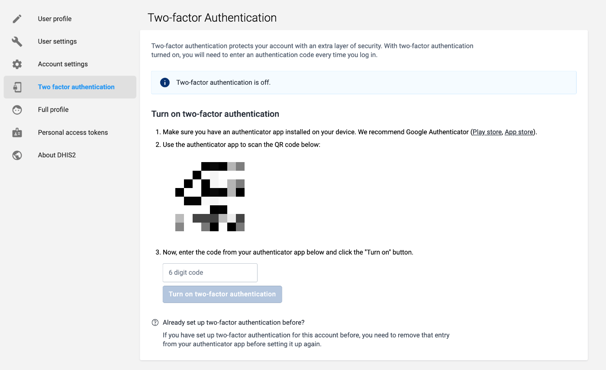

Your administrator decides which methods are available. In v42 and later, there are two methods:

-   **Authenticator app**: you enter a code from an authenticator app on your device. The app recommends Google Authenticator.
-   **Email**: you enter a code that DHIS2 sends to your verified email address.

If both methods are available, a method selector with the options **Authenticator app** and **Email** appears before the instructions. When two-factor authentication is on, the selector shows your current method and is disabled. You can use only one method at a time. To switch methods, turn off two-factor authentication first.

### Turn on 2FA with an authenticator app { #user_profile_2fa_totp }

To turn on two-factor authentication with an authenticator app:

1. In the sidebar, choose **Two factor authentication**. You can also click **Setup 2-Factor** on the **Account settings** page.
2. If the method selector appears, choose **Authenticator app**.
3. Install an authenticator app on your device. Use the links **Play store** or **App store** on the page to get Google Authenticator.
4. In the authenticator app, scan the QR code on the page.
5. In **6 digit code**, enter the code that the authenticator app shows.
6. Click **Turn on two-factor authentication**.

The button is disabled until you enter exactly six digits. DHIS2 shows the message **Two factor authentication was enabled successfully** and the status **Two-factor authentication is on.**

If you set up two-factor authentication for this account before, remove that entry from your authenticator app first. Then scan the new QR code.

### Turn on 2FA with email { #user_profile_2fa_email }

Email is available in v42 and later. Your email address must be verified before you can use it for two-factor authentication. If it is not verified, the page shows a warning and the link **Verify your email here.**, which opens the **User profile** page. See [Verify your email address](#user_profile_verify_email).

To turn on two-factor authentication with email:

1. In the sidebar, choose **Two factor authentication**.
2. If the method selector appears, choose **Email**.
3. Click **Send authentication code**. DHIS2 sends a code to the email address shown on the page, and shows the message **Authentication code sent**.
4. In **6 digit code**, enter the code from the email.
5. Click **Turn on two-factor authentication**.

If you do not receive the code, check your spam or junk folder. If you still do not receive it after a few minutes, click **Send a new code**.

### Turn off 2FA { #user_profile_2fa_off }

To turn off two-factor authentication with an authenticator app:

1. In the sidebar, choose **Two factor authentication**.
2. Open your authenticator app and read the current code.
3. In **6 digit code**, enter the code.
4. Click **Turn off two-factor authentication**.

DHIS2 then shows the notice **Remove two-factor account**. Remove the account from your authenticator app, to prevent problems when you turn on two-factor authentication again.

To turn off two-factor authentication with email:

1. In the sidebar, choose **Two factor authentication**.
2. Click **Send authentication code**.
3. In **6 digit code**, enter the code from the email.
4. Click **Turn off two-factor authentication**.

### If you lose access to your second factor { #user_profile_2fa_locked }

If you lose access to your authenticator app or to your email, you cannot log in. Ask an administrator to reset two-factor authentication for your account. Administrators do this in the Users app. See [Reset two factor authentication for a user](#user_disable_2fa).

## View your full profile { #user_profile_full }

The **Full profile** page shows a read-only summary of your profile.

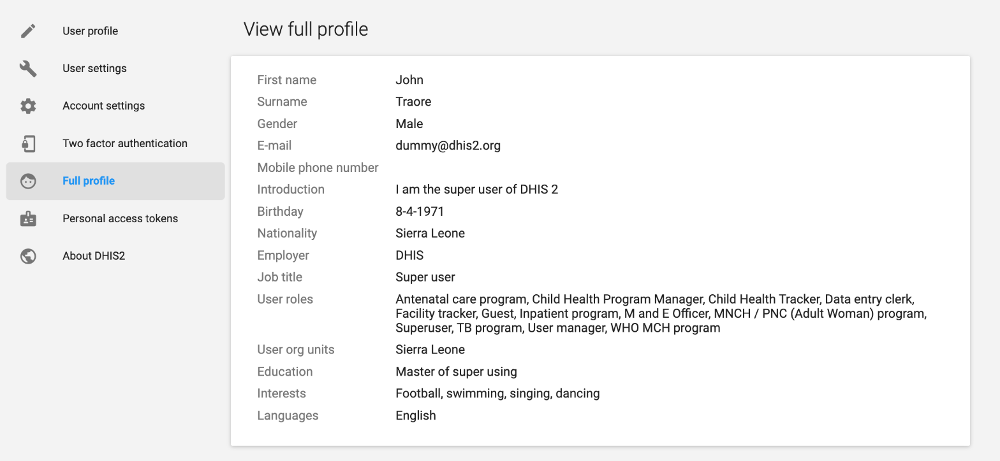

The summary has these fields: **First name**, **Surname**, **Gender**, **E-mail**, **Mobile phone number**, **Introduction**, **Birthday**, **Nationality**, **Employer**, **Job title**, **User roles**, **User org units**, **Education**, **Interests**, and **Languages**. You cannot edit **User roles** and **User org units** yourself. An administrator assigns them in the [Users](#users_app) app.

## Manage personal access tokens { #user_profile_tokens }

On the **Personal access tokens** page, you create and delete personal access tokens. A personal access token is an alternative to a password for scripts and external apps that use the DHIS2 API. To send requests with a token, limit what a token can do, and fix token errors, see [How to use personal access tokens](#how_to_use_pats).

> **Important**
>
> A token has all the authorities of your user account. Limit the access that you give to each token. See [Limit what a token can do](#how_to_use_pats_limits).

### Create a personal access token { #creating_pats }

When you create a token, you choose the context where you use the token. Both contexts let you set an expiration date and the allowed HTTP methods.

Table: Contexts for a personal access token

| Context                   | Use it for                                                | Restriction that only this context offers |
| ------------------------- | --------------------------------------------------------- | ----------------------------------------- |
| **Server/script context** | Integrations and scripts that a web browser does not run. | **Allowed IP addresses**                  |
| **Browser context**       | Apps that a web browser opens, such as public portals.    | **Allowed referrers**                     |

To create a token:

1. In the sidebar of the **User Profile** app, click **Personal access tokens**.

    The **Manage personal access tokens** page lists your tokens. If you have no tokens, the page says that you do not have any active personal access tokens.

    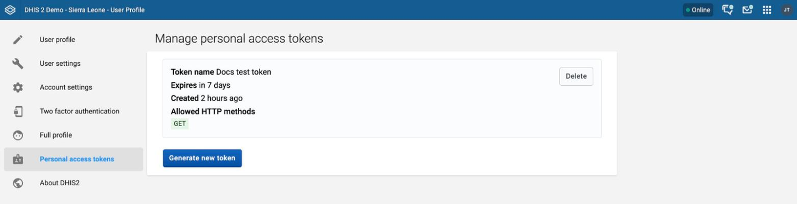{ width=70% }

2. Click **Generate new token**.

3. Choose the context: **Server/script context** or **Browser context**.

    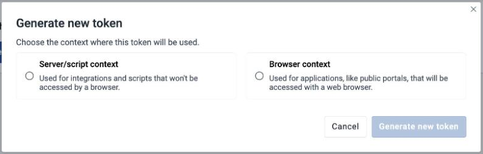{ width=50% }

4. Under **Token details**, enter a **Token name**. The name must be unique among your tokens.

    > **Note**
    >
    > The **Token name** field is available from User Profile app version 100.7.6. DHIS2 2.41.5 and later and DHIS2 2.42.2 and later bundle this app version or a later one. Earlier bundled versions have no name field.

5. Choose an **Expiration (required)** period: **7 days**, **30 days** (the default), **60 days**, or **90 days**. To set your own date, choose **Custom...** and enter a future date in **Custom expiration date (required)**. The dialog shows the date on which the token expires.

6. Optional: Set the restriction for the context.

    - For the server/script context, enter the **Allowed IP addresses**, one address on each line. If you leave the field empty, the token has no IP address restriction.
    - For the browser context, enter the **Allowed referrers**, one URL on each line, in lowercase. If you leave the field empty, the token has no referrer restriction.

    When you generate a browser context token, a confirmation message tells you to use browser tokens only on public access instances. On private instances, route requests through a proxy.

    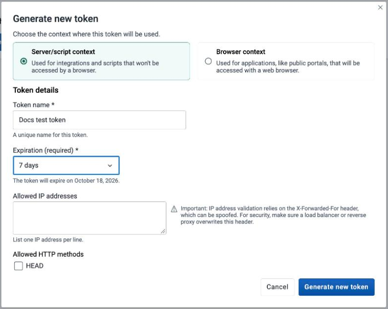{ width=50% }

7. Optional: Under **Allowed HTTP methods**, choose the methods that the token can use. The options are **HEAD**, **GET**, **POST**, **PUT**, **PATCH**, and **DELETE**. **GET** is chosen by default. Choose only the methods that the token needs. If you clear every method, the token can use any method.

    > **Note**
    >
    > The **HEAD** method is available from v43. In v42 and earlier, the list has no **HEAD** option.

8. Check the list **This token will have the following authorities**. It shows every authority that the token inherits from your user account.

    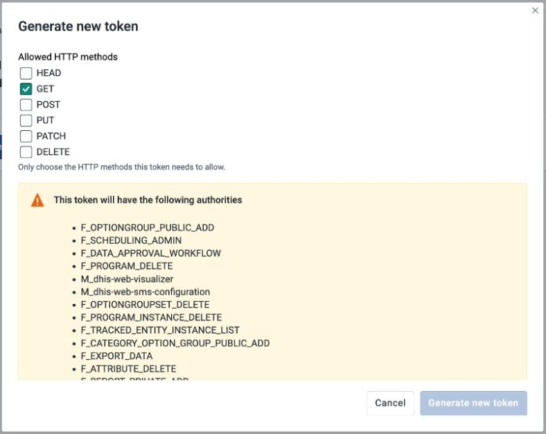{ width=50% }

9. Click **Generate new token**.

10. Copy the token and store it in a secure place. Click **Copy to clipboard** to copy it.

    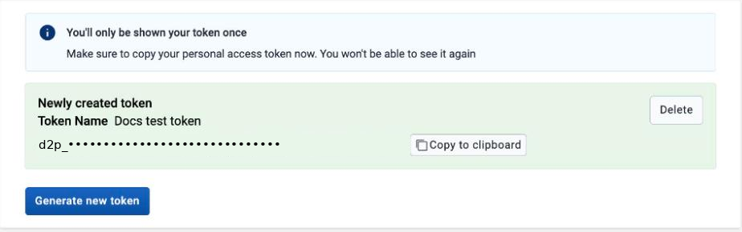{ width=70% }

> **Important**
>
> DHIS2 shows the token only once. After you leave the page, you cannot see it again. DHIS2 stores only a hash of the token in the database. This limits the impact if someone gets unauthorized access to the database.

### Delete a personal access token { #deleting_pats }

Each token on the **Manage personal access tokens** page shows its **Token name** (if the token has one), when it expires (**Expires**), when it was created (**Created**), and its **Allowed HTTP methods**. It also shows the allowed IP addresses or referrers when you set them.

1. Open the **Manage personal access tokens** page.

2. On the token that you want to remove, click **Delete**.

3. In the confirmation dialog, click **Delete token**.

    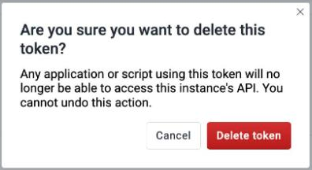{ width=30% }

Any application or script that uses the token can no longer access the API of the instance. You cannot undo this action.

## View system information { #user_profile_about }

The **About DHIS2** page, with the heading **System info**, shows details about the DHIS2 instance. These details include the DHIS2 version, the build revision, the build date, the time of the last analytics table generation, the system ID, and the calendar. The link **Browse it here** opens the Web API.
